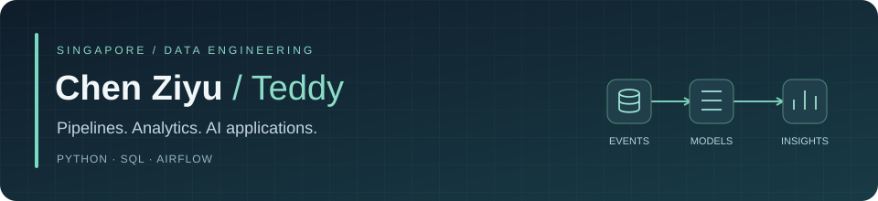
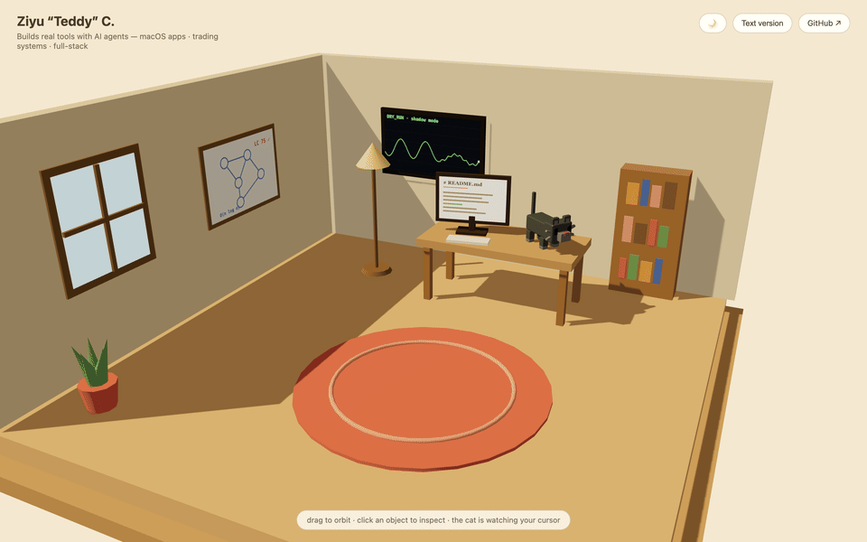

  

  <a href="https://www.linkedin.com/in/teddyczy/">LinkedIn</a> ·
  <a href="https://teddy8023mars.github.io">Interactive portfolio</a> ·
  <a href="#data-engineering-labs">Explore the code</a>

I’m **Teddy**, a data engineer based in Singapore. At work, I turn product questions into SQL datasets, scheduled pipelines and tools people can use themselves. Outside work, I build things I want on my own desktop.

**Manus AI** · Previously **Tencent Games** · Earlier internship at **Shopee, Search & Recommendation**  
**M.Sc., Computer Engineering — NUS** · **B.Eng., Electrical & Electronic Engineering — NTU**

## What I work on

- **Pipelines and warehouse models:** Python, SQL and Airflow; incremental loads, validation, backfills and production troubleshooting.
- **Product analytics:** subscription and cost data for AI products; player activity, retention and match data from my earlier work on overseas MOBA operations.
- **Self-service data tools:** Slack-integrated analytics, OAuth, query authorization and audit logging, with engineering and database partners.

My professional work lives in company repositories. The projects below are personal work you can inspect here.

## Data engineering labs

Three new personal labs built with AI assistance and synthetic data. Each has a runnable demo, tests and documented limitations.

**Try the demos:** [Player analytics](https://teddy8023mars.github.io/moba-analytics-lab/) · [Failure and recovery replay](https://teddy8023mars.github.io/incremental-load-lab/) · [Quality gate explorer](https://teddy8023mars.github.io/data-quality-gates/)

| Lab | Engineering focus | Demo and evidence |
|:--|:--|:--|
| **[MOBA Analytics Lab](https://github.com/teddy8023mars/moba-analytics-lab)** | DuckDB + SQL warehouse; event deduplication, fact grains, D1/D7 cohort retention and payment metrics | [Live dashboard](https://teddy8023mars.github.io/moba-analytics-lab/) · [Metric definitions](https://github.com/teddy8023mars/moba-analytics-lab/blob/main/docs/metrics.md) · [Sample outputs](https://github.com/teddy8023mars/moba-analytics-lab/tree/main/examples/report) |
| **[Incremental Load Lab](https://github.com/teddy8023mars/incremental-load-lab)** | Transactional checkpoints, versioned upserts, tombstones, replay and failure recovery in SQLite | [Interactive replay](https://teddy8023mars.github.io/incremental-load-lab/) · [Recorded evidence](https://github.com/teddy8023mars/incremental-load-lab/blob/main/docs/demo-output.json) |
| **[Data Quality Gates](https://github.com/teddy8023mars/data-quality-gates)** | Declarative CSV contracts; six checks, structured reports and explicit CI exit codes | [Interactive report](https://teddy8023mars.github.io/data-quality-gates/) · [Example contract](https://github.com/teddy8023mars/data-quality-gates/blob/main/examples/contract.json) · [Detected violations](https://github.com/teddy8023mars/data-quality-gates/blob/main/docs/dirty-report.json) |

## Selected projects

| Project | What I built | Where to start |
|:--|:--|:--|
| **[LeetCode Tracker](https://github.com/teddy8023mars/leetcode-tracker)** | A practice app with bilingual problem ingestion, scheduled sync, progress tracking and a local judge. **TypeScript · React · tRPC · MySQL** | [Schema](https://github.com/teddy8023mars/leetcode-tracker/blob/master/drizzle/schema.ts) · [Sync orchestration](https://github.com/teddy8023mars/leetcode-tracker/blob/master/server/sync/orchestrator.ts) · [CI](https://github.com/teddy8023mars/leetcode-tracker/actions/workflows/ci.yml) |
| **[Skin Lesion Analysis](https://github.com/teddy8023mars/Skin-lesion-classification)** | My first deep-learning project, revisited with segmentation, classification and an evaluation retrospective that documents leakage and failed experiments. **Python · TensorFlow** | [Results and limitations](https://github.com/teddy8023mars/Skin-lesion-classification#results) · [Saved metrics](https://github.com/teddy8023mars/Skin-lesion-classification/blob/main/assets/task3-results.json) |
| **[QuickMD](https://github.com/teddy8023mars/QuickMD)** | A native macOS Markdown viewer with diagrams, math, live reload and PDF export. **Objective-C · AppKit · WKWebView** | [Screenshot and setup](https://github.com/teddy8023mars/QuickMD) · [Native app](https://github.com/teddy8023mars/QuickMD/blob/main/src/main.m) · [Rendering tests](https://github.com/teddy8023mars/QuickMD/tree/main/test) |
| **[DeskCat](https://github.com/teddy8023mars/DeskCat)** | A desktop companion with a procedural teddy bear, cursor tracking and idle animations. **Swift · SceneKit** | [English overview](https://github.com/teddy8023mars/DeskCat#english-overview) · [Procedural model](https://github.com/teddy8023mars/DeskCat/blob/main/Sources/DeskCat/TeddyModel.swift) |

The tracker’s judge is for local development, not a hardened public execution service. The skin-lesion project is an experiment, not a clinical tool. Both repositories explain their limitations alongside the implementation.

## Tools I use

| At work | In personal projects |
|:--|:--|
| Python · SQL · Airflow | TypeScript · React · tRPC |
| Redshift · TiDB/MySQL · AWS | TensorFlow · Jupyter |
| Git · pytest · CI/CD | Objective-C · Swift · AppKit · SceneKit |

How I build

I use AI coding assistants for implementation and review. I focus on understanding the design, checking the results and documenting the limitations.

## A little outside the warehouse

My [portfolio](https://teddy8023mars.github.io) is a small Three.js studio. Click around the room; the cat follows your cursor. There’s a **Text version** if you’d rather skip the 3D.

Also: [a restock notification tool](https://github.com/teddy8023mars/fk_popmart), diving, and more side projects than spare weekends. English / 中文都可以。
